<!-- ─────────────────────────────── BOOT ─────────────────────────────── -->
<p align="center">
  
</p>

<p align="center">
  <a href="https://github.com/SwadheenMishra">
    
  </a>
</p>

<p align="center">
  <a href="https://www.linkedin.com/in/swadheenmishra/" target="_blank"></a>
  
</p>

<br/>

### `~/whoami`

```yaml
name:      Swadheen Mishra
role:      developer · maker · tinkerer
builds:
  - games            # Unity + C#
  - websites         # HTML, CSS, Flask
  - computer-vision  # OpenCV + TensorFlow
  - hardware         # Arduino, Raspberry Pi
speaks:    [C++, C#, Java, Python]
runs_on:   linux
status:    always building something
```

### `~/stack`

<table align="center">
  <tr>
    <td align="center" width="25%"><code>hardware/</code></td>
    <td align="center" width="25%"><code>languages/</code></td>
    <td align="center" width="25%"><code>vision-ai/</code></td>
    <td align="center" width="25%"><code>games-web/</code></td>
  </tr>
  <tr>
    <td align="center"></td>
    <td align="center"></td>
    <td align="center"></td>
    <td align="center"></td>
  </tr>
</table>

### `~/stats`

<p align="center">
  
  
</p>

### `~/activity`

<p align="center">
  <picture>
    <source media="(prefers-color-scheme: dark)" srcset="https://raw.githubusercontent.com/SwadheenMishra/SwadheenMishra/output/snake-dark.svg" />
    <source media="(prefers-color-scheme: light)" srcset="https://raw.githubusercontent.com/SwadheenMishra/SwadheenMishra/output/snake.svg" />
    
  </picture>
</p>

<br/>

<!-- ─────────────────────────────── EXIT ─────────────────────────────── -->
<p align="center">
  
</p>
